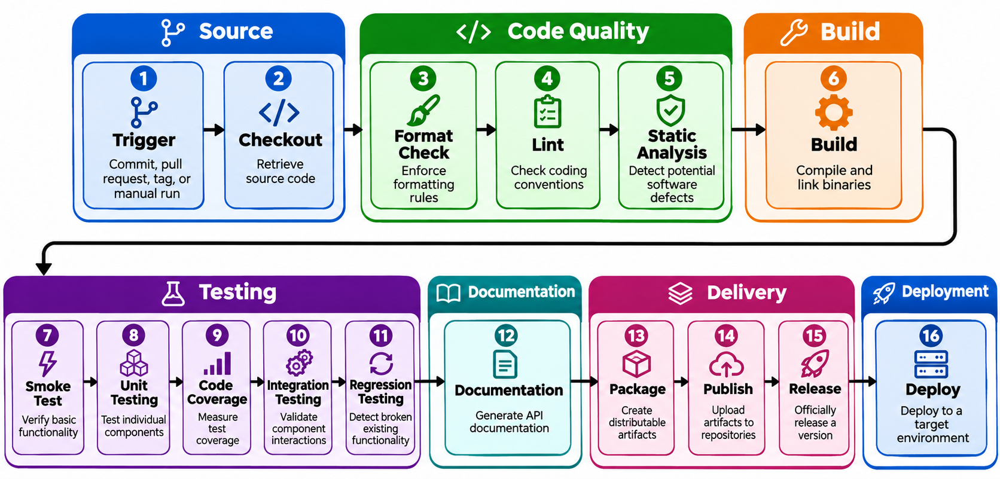
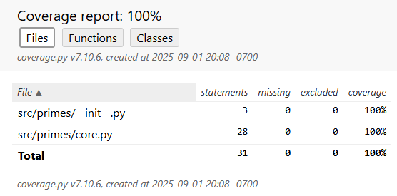

# Primes-Python

Primes-Python is a lightweight Python project designed as a practical testbed for a complete CI pipeline. The codebase is intentionally simple: a minimal library with functions such as integer addition and prime number detection, accompanied by unit tests to validate correctness.

By keeping the application itself simple, the project emphasizes the end-to-end automation flow from checkout to publish, making it ideal for experimenting with Python toolchains, validating pipeline configurations, and serving as a template for larger Python projects.

> For details on how this project is integrated into a full CI/CD workflow, refer to the [jenkins-pipeline](https://github.com/ManiAm/Jenkins-pipeline) project.

## Project Layout

The project is organized as follows:

    Project Root
    ├── src/                     # Package source
    │   └── primes/
    │       ├── __init__.py
    │       └── core.py
    ├── tests/                   # Unit tests
    │   ├── __init__.py
    │   └── test_core.py
    ├── Makefile                 # Automation (format, lint, test, build)
    ├── requirements.txt         # Development dependencies
    ├── pyproject.toml           # Build system / tool configuration
    ├── Jenkinsfile              # CI pipeline definition
    ├── Dockerfile               # Container build definition
    └── docker-compose.yml       # Docker compose definition

### src/

The `src/` directory contains the actual implementation of the Python package. Organizing source code under `src/` is a widely recommended layout because it prevents accidental imports of the local package when running tests or scripts from the project root. In this project, `primes/` includes the core functionality and an `__init__.py` file makes the directory a proper Python package.

### tests/

The `tests/` directory contains the project's unit tests, ensuring that individual components of the package behave as expected. Tests are structured in parallel with the source code layout, making it straightforward to locate corresponding tests for each module.

### Makefile

The Makefile serves as a convenient automation layer for common development tasks such as formatting, linting, testing, and building. By standardizing these commands, developers can run complex toolchains with simple, memorable commands (e.g., `make lint` or `make build`). This design ensures that the local developer workflow matches the CI pipeline exactly, making the Makefile a single entry point for all routine project operations.

## CI Pipeline

A `Jenkinsfile` is a plain text file, written in Groovy-based syntax, that defines a Jenkins pipeline as code. It specifies the stages, steps, and environment required to build, test, and deploy an application. By treating the pipeline as code, teams gain consistency, collaboration, and traceability, since changes to the CI process are reviewed, versioned, and managed just like application code. Each branch, tag, or commit can carry its own pipeline definition, making the CI process fully reproducible and context-aware.

The following table shows the recommended logical sequence of pipeline stages, grouped by phase. This is not a mandatory CI/CD standard. Jenkins supports sequential stages, parallel stages, and conditional execution, so the exact flow can be adapted to fit project needs.

| Phase         | #  | Stage                | Purpose                                    |
|---------------|----|----------------------|--------------------------------------------|
| Source        | 1  | Trigger              | Commit, pull request, tag, or manual run   |
| Source        | 2  | Checkout             | Retrieve source code                       |
| Code Quality  | 3  | Format Check         | Enforce formatting rules                   |
| Code Quality  | 4  | Lint                 | Check coding conventions                   |
| Code Quality  | 5  | Static Analysis      | Detect type errors and security issues     |
| Build         | 6  | Build                | Build distributable packages               |
| Testing       | 7  | Smoke Test           | Verify basic functionality                 |
| Testing       | 8  | Unit Testing         | Test individual components                 |
| Testing       | 9  | Code Coverage        | Measure test coverage                      |
| Testing       | 10 | Integration Testing  | Validate component interactions            |
| Testing       | 11 | Regression Testing   | Detect broken existing functionality       |
| Documentation | 12 | Documentation        | Generate API documentation                 |
| Delivery      | 13 | Package              | Create distributable artifacts             |
| Delivery      | 14 | Publish              | Upload artifacts to repositories           |
| Delivery      | 15 | Release              | Officially release a version               |
| Deployment    | 16 | Deploy               | Deploy to a target environment             |

### Trigger

The trigger stage defines what initiates a pipeline run. Common triggers include a commit push, a pull request event, a tag creation, or a manual (parameterized) build. In Jenkins, triggers are configured through the `Jenkinsfile` using directives such as `triggers`, `when`, or webhook integrations.

Defining triggers explicitly makes the pipeline predictable: developers know exactly which events cause a build, and conditional logic can skip or include stages based on the trigger type. For example, a pull request might run only code quality and testing stages, while a tag push triggers the full pipeline through to release.

### Checkout

The checkout stage retrieves the project's source code from version control at the specific commit or branch associated with the build, ensuring that subsequent stages run against a consistent snapshot of the codebase. Depending on configuration, this may include checking out submodules, applying shallow clones to reduce network overhead, or verifying commit integrity for security.

### Code Formatting

Code formatting ensures that all Python source files follow a consistent, automated style, eliminating subjective debates about whitespace, indentation, and line wrapping. This project uses `Black`, an opinionated formatter that rewrites code deterministically according to a single standard. Unlike traditional style checkers, `Black` does not simply report violations — it actively modifies code to comply, ensuring that every developer produces the same layout regardless of their editor or habits.

Developers can use `make format` to automatically reformat files before committing, while pre-commit hooks help catch violations before they enter the repository. In continuous integration, `make format-check` runs `Black` in verification mode and fails if any files deviate from the expected style. This guarantees that all branches and pull requests adhere to the same formatting rules, keeping diffs clean and code reviews focused on logic rather than style.

### Linting

Linting checks Python code for style, convention, and maintainability issues without modifying files. Unlike a formatter, which only changes layout, a linter flags constructs that violate established policy, such as naming conventions, docstring requirements, unused variables, import hygiene, and bug-prone constructs like undefined variables or unreachable code.

This project uses `Pylint`, which analyzes code structure and enforces a configurable set of rules. In practice, `Pylint` complements `Black` by focusing on policy and correctness rather than layout. Developers can run `make lint` to review warnings without blocking progress.

[Ruff](https://github.com/astral-sh/ruff) is a modern alternative that combines linting and formatting into a single, high-performance tool. Written in Rust, it implements a wide range of rules inspired by established tools like `Pylint`, `Flake8`, and `pycodestyle`, while also supporting auto-formatting features similar to `Black`. Its design philosophy is to provide comprehensive coverage with minimal configuration overhead, making it suitable for large codebases or frequent CI checks.

### Static Code Analysis

Static analysis in Python goes beyond linting and formatting by examining program semantics without executing the code. While `Pylint` performs some lightweight static checks, it does not provide full type validation or security scanning. To close these gaps, this project uses two additional tools:

- **Mypy** (type checking): Mypy uses Python's type annotations ([PEP 484](https://peps.python.org/pep-0484/)) to validate function signatures, variable types, and interactions between modules. This helps catch subtle bugs, such as passing a string where an integer is expected, before they reach runtime.

- **Bandit** (security analysis): Bandit focuses on identifying common security issues in Python code: use of `eval`, weak cryptographic functions, hardcoded secrets, or insecure subprocess usage.

Together, these tools extend the safety net beyond style and conventions, ensuring code is not only readable but also robust and secure.

In CI/CD, serious static analysis findings (type errors, high-severity security issues) should be treated as build-breaking, while lower-severity issues may surface as warnings for incremental cleanup. Running `mypy` and `bandit` early in the pipeline provides developers with fast, actionable feedback and reduces the risk of bugs or vulnerabilities reaching production.

### Build

In Python, the build stage prepares a project for distribution by transforming its source code and associated metadata into standardized artifacts. Unlike compiled languages such as C or C++, Python does not require compilation to machine code. However, it does require a packaging mechanism that allows projects to be distributed, installed, and reproduced reliably across different environments.

The build process captures essential metadata, including dependency declarations, licensing details, supported Python versions, entry points, and versioning information. This metadata allows tools like `pip` to install packages consistently and enables reproducible builds.

Over time, the Python packaging system has evolved through several stages: initially with `distutils`, later with `setuptools`, and more recently with modern [PEP 517](https://peps.python.org/pep-0517/)–compliant tools such as the `build` frontend. Distribution formats have transitioned from `sdist` and `egg` to the widely adopted `wheel` format, each step addressing limitations of its predecessors.

This project uses the `build` frontend to generate both `sdist` (source distribution) and `wheel` (binary distribution) packages. By producing both, the project ensures maximum compatibility: `sdist` serves users who need to build from source or adapt the package to custom environments, while `wheel` provides the most efficient installation path for the majority of end users.

### Smoke Test

A smoke test is a lightweight check performed immediately after a successful build to verify that the resulting artifact is minimally functional. In Python, this typically means installing the built wheel into a fresh virtual environment and confirming that the package can be imported and that basic functionality works. The goal is not to validate correctness or cover all features, but simply to confirm that the build is healthy and stable enough to proceed with deeper testing. A failing smoke test typically signals a critical issue, such as a missing dependency, broken import, or packaging error, that must be resolved before further tests are worthwhile.

> The term originates from hardware engineering. When technicians powered on a newly assembled circuit board for the first time, their simplest test was to see whether it emitted smoke. If it did, something was fundamentally broken and they stopped there. This pragmatic check carried over into software engineering as a metaphor for catching catastrophic failures early. Today, in CI/CD pipelines, smoke tests serve as the first line of defense: fast, lightweight checks that prevent wasting time and resources on builds that are already broken.

Note that a separate deployment smoke test can also be performed after the Deploy stage to verify that the application functions correctly in the target environment.

### Unit Testing

Unit testing verifies the smallest components of the codebase (functions, classes, or modules) in isolation. These tests ensure that individual units behave as expected given specific inputs. Unit tests should avoid external dependencies such as databases or networks, making them fast to execute and deterministic in results. They provide developers with immediate feedback during both local development and CI pipeline runs.

This project uses [pytest](https://docs.pytest.org/) for unit testing, with `make test` as the entry point. Test runs produce JUnit XML output, which CI systems can consume to visualize results, track historical trends, and highlight failures early in the development cycle.

### Code Coverage

Code coverage measures how much of the source code is exercised by tests. It is important to understand that coverage is a measurement, not a testing method. Tests run against an instrumented build, and the resulting data shows which lines, branches, or functions were executed. Coverage can be collected from unit tests, integration tests, or both.

While coverage is not a direct measure of test quality, it is a valuable indicator of risk. Maintaining a high level of coverage ensures that critical paths are validated and reduces the likelihood of undetected regressions. Striving for 100% coverage is often impractical and unnecessary, but consistently tracking coverage helps identify blind spots.

This project collects coverage using `pytest` with the `--cov` flag (via the `pytest-cov` plugin), which records line, branch, and function execution during testing. Reports are generated in both human-readable HTML and machine-readable formats (e.g., Cobertura XML) for automated enforcement. Coverage gates are best applied pragmatically: enforce no decrease relative to the main branch or set thresholds per change, rather than rigid global minimums that encourage low-value tests.

### Integration Testing

Integration testing validates that multiple components work correctly when combined. While unit tests prove correctness in isolation, integration tests catch issues that only appear when components interact, for example, a module calling into an external service, a data pipeline feeding processed results into a downstream consumer, or a web framework routing requests to handler functions. Integration tests may involve real or simulated dependencies and tend to run slower than unit tests, but they are critical for uncovering systemic issues.

A popular analogy highlights the difference: imagine a door secured by both a lock and a latch. A unit test checks that the latch closes correctly when tested in isolation, while an integration test verifies that the latch and the door handle together actually keep the door secure. This distinction illustrates why both levels of testing are needed for confidence in a system's overall behavior.

Integration tests normally run after unit tests. However, they can also be moved after the Package stage if the goal is to validate the actual installable artifact rather than the source tree.

### Regression Testing

Regression testing is the process of re-executing previously run test cases to ensure that recent code changes have not unintentionally broken existing functionality. Unlike unit or integration testing, which target specific levels of the software, regression testing is a strategy applied across all levels. Its primary goal is to confirm that the system continues to behave as expected after modifications. A regression suite can include unit tests, integration tests, and end-to-end tests.

In practice, regression testing involves maintaining a suite of automated tests that are rerun whenever the codebase changes. This ensures that new features integrate smoothly, bug fixes do not reappear, and overall system stability is preserved. Because it validates the unchanged parts of a system after updates, regression testing is essential in CI/CD pipelines where frequent changes must not compromise reliability. For larger projects, a dedicated regression stage allows extended test suites to run without slowing down the core testing phase.

### Documentation

Documentation is a critical component of any Python project. Its purpose is to explain how the system is built, how to use it, and how others can extend or integrate with it. Clear documentation reduces onboarding time for new developers, helps users understand APIs and build procedures, and ensures long-term maintainability by preserving the reasoning behind design choices.

This project uses [Sphinx](https://www.sphinx-doc.org/en/master/) to generate documentation. Sphinx is one of the most widely used documentation tools in the Python ecosystem, originally created for the official Python documentation itself. It allows content to be written in `reStructuredText` or `Markdown` and automatically generates professional, navigable documentation sites in HTML, PDF, and other formats. One of its strengths is tight integration with Python code through `autodoc`, which pulls docstrings directly from the codebase, ensuring that documentation stays in sync with the source. Sphinx also has a large ecosystem of extensions for theming, search, API references, and diagrams, making it a de facto standard for Python projects.

Documentation is generated before the Package stage so that generated docs can be included in the distributable artifact. If documentation is not part of the artifact, this stage can run in parallel with the testing stages to save pipeline time.

### Package

The package stage bundles the project into a distributable form after it has successfully passed all quality checks. In this project, `make package` orchestrates the full pipeline and produces a versioned tarball containing the Python build artifacts (`sdist` and `wheel`), documentation, test reports, analysis reports, and metadata. This ensures that every release is reproducible, auditable, and self-contained.

Each artifact should be versioned using semantic versioning with optional commit metadata (e.g., `0.1.0+abc123`) to ensure traceability. To guarantee integrity, checksums (e.g., SHA-256) are generated alongside the artifact. The artifact should be built once and then promoted through subsequent delivery and deployment stages without being rebuilt, ensuring that the exact same validated package is what reaches consumers.

### Publish

Publishing makes validated artifacts available to others by promoting them to their designated destinations. For Python projects, common targets include [PyPI](https://pypi.org/) (the Python Package Index), private package repositories (e.g., Artifactory, Nexus, devpi), or distribution platforms such as GitHub Releases.

Publishing credentials must follow the principle of least privilege and be rotated regularly. Tools like `twine` are used to upload packages to PyPI securely. Published artifacts should be annotated with changelogs, version tags, and links back to the originating build for full traceability. To strengthen consumer trust, optional metadata such as SLSA provenance attestations, SBOMs, and digital signatures can be attached so downstream users can verify authenticity and integrity before installation.

### Release

A release marks the formal distribution of a software version to end users, distinguishing it from internal builds or unpublished artifacts. It is both a technical milestone and a product event, usually represented by a semantic version tag (e.g., `v1.2.0`) in source control. A release should be immutable, reproducible, and traceable to a specific commit and build pipeline.

A proper release includes release notes summarizing new features, bug fixes, and breaking changes, ideally auto-generated from commits or pull requests. Distribution is handled through established channels such as GitHub/GitLab Releases, PyPI, or internal delivery pipelines. In mature CI processes, releases are gated by quality controls (security scans, compliance checks, stakeholder approvals) and may trigger downstream workflows such as deployment or customer notifications.

The release stage typically runs conditionally, for example only on approved builds or tagged commits, rather than on every pull request.

In summary:

- **Package** → Create artifacts
- **Publish** → Push artifacts to repositories/registries
- **Release** → Tag and announce an official version for end users

### Deploy

The deploy stage delivers a released artifact to a target environment such as staging, production, or a customer-facing platform. For running services (e.g., web servers, microservices), deployment may be automated through continuous deployment or gated through continuous delivery with manual approval.

For libraries and standalone packages, a formal deploy stage may not be necessary since the Publish and Release stages already make the artifact available to consumers via PyPI or other registries. When deployment does apply, it is important to distinguish between continuous delivery (artifact is always ready to deploy but requires manual approval) and continuous deployment (artifact is automatically deployed after passing all pipeline gates).

A post-deployment smoke test is recommended to verify that the application functions correctly in the target environment before routing user traffic.

## Ephemeral Docker Build Environment

The Jenkins pipeline is designed so that all build, test, and analysis stages run inside ephemeral Docker containers rather than directly on the Jenkins agent. At the start of the pipeline, Jenkins builds the project's Docker image (as defined in the Dockerfile) to encapsulate the full toolchain, dependencies, and runtime environment. Subsequent stages are executed inside disposable containers instantiated from this freshly built image.

This approach provides several advantages:

- **Clean Separation of Concerns**: The Jenkins agents only need Docker installed; they do not require Python, pip, or any project-specific libraries. All dependencies remain confined within the container image.

- **Consistency and Reproducibility**: Because the image is built from a version-controlled Dockerfile, every pipeline run uses the exact same environment. This eliminates discrepancies between developer machines and CI agents.

- **Polyglot Flexibility**: Different pipelines can provide different Dockerfiles, making it straightforward to support multiple languages or toolchains without cross-contamination.

- **Stateless Execution**: Containers are ephemeral. Once a stage completes, the container is discarded, leaving no residual state behind. Each run starts from a clean, deterministic environment, which improves the reliability of test results, static analysis, and coverage reports.

By adopting this model, the pipeline remains portable, maintainable, and free from dependency drift, while still enabling Jenkins to orchestrate the stages inside containerized environments.

## Getting Started

The steps below follow the same order as the CI pipeline stages described above.

### 1. Start the Build Environment

Start the container in background:

    docker compose up -d --build

Open an interactive shell to the container:

    docker exec -it primes-python bash

All subsequent commands are run inside the container.

### 2. Code Formatting

To check that all source files comply with `Black`'s formatting rules without making changes:

    make format-check

To automatically rewrite all source files to match the project's style:

    make format

### 3. Linting

To run `Pylint` and detect style, convention, and potential error issues:

    make lint

### 4. Static Analysis

To perform static type checking with `Mypy`:

    make type

To run security analysis using `Bandit`:

    make sec

### 5. Build

To build the project into distributable artifacts (`sdist` and `wheel`) under the `dist/` directory:

    make build

### 6. Smoke Test

To verify that the built wheel can be installed and imported in a clean environment:

    make smoke

This installs the wheel into a fresh virtual environment and confirms the package imports correctly. The smoke test acts as a lightweight gate before running the full test suite.

### 7. Unit Testing

To run the unit tests using `pytest`:

    make test

### 8. Code Coverage

To run the test suite with coverage instrumentation enabled:

    make coverage

This generates a coverage report showing which parts of the codebase are executed by tests.

### 9. Documentation

To build the project documentation using `Sphinx`:

    make docs

Source files under `docs/` are compiled into static HTML output under `docs/build/html/`. The generated site can be viewed locally:

    cd docs/build/html
    python3 -m http.server 8082

Then access it in your browser at `http://localhost:8082/`.

### 10. Package

To create a complete release tarball containing all build artifacts, reports, and documentation:

    make package

This target orchestrates the full pipeline and then bundles the results into a versioned `.tar.gz` archive, including metadata (commit SHA, build date, Python version) for traceability. A checksum file (`.sha256`) is also generated to verify integrity.
